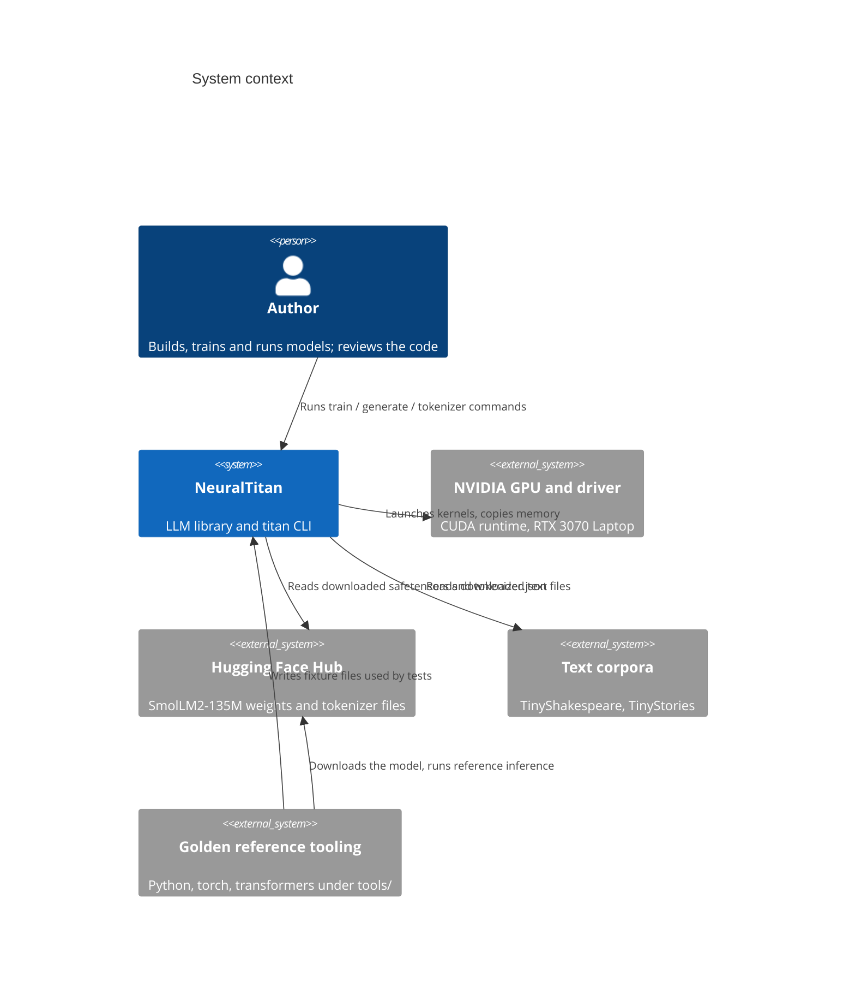
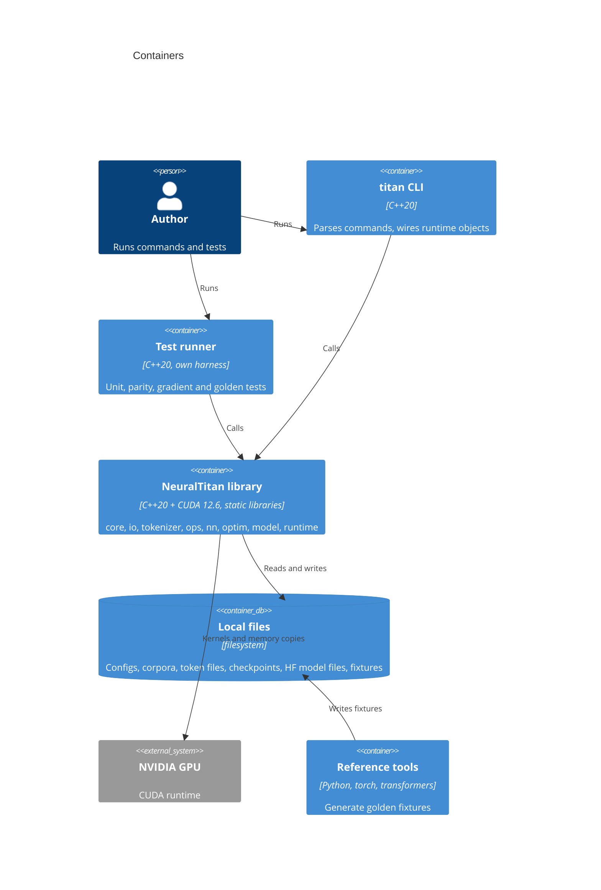
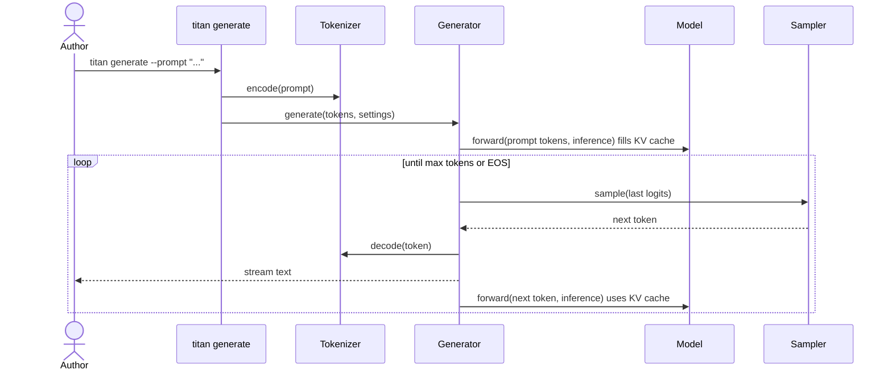
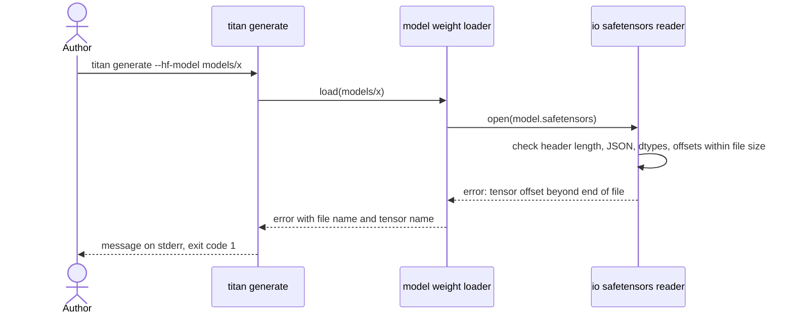
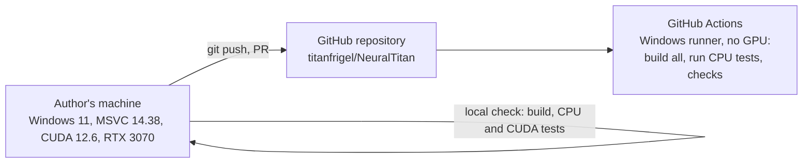

# Architecture overview

<!-- Structure follows arc42-lite. -->

## 1. Context and scope

NeuralTitan is a C++/CUDA library plus a `titan` command-line program, running on a single Windows machine with one NVIDIA GPU. Nothing runs as a service; every interaction is a local process reading and writing local files.



- **Author.** Runs the `titan` CLI and the test suite, and reviews the code and math notes. Single user, local machine.
- **NVIDIA GPU and driver.** Reached only through the CUDA runtime API, from the `cuda` part of the `ops` layer and the device memory code in `core`.
- **Hugging Face Hub.** NeuralTitan never makes network calls. Weight (`*.safetensors`), config (`config.json`) and tokenizer (`tokenizer.json`) files are downloaded beforehand into a local `models/` directory (git-ignored), then read by the `io` and `tokenizer` layers.
- **Text corpora.** Plain text files downloaded into a local `data/` directory (git-ignored) and tokenized into binary token files by `titan`.
- **Golden reference tooling.** Development-only Python scripts under `tools/` (ADR 0004). They produce fixture files committed under `tests/fixtures/`. They are never invoked by the build or the tests.

## 2. Solution strategy

- **Layered architecture with swappable device backends** (ADR 0005). Calls follow the math top to bottom. Device polymorphism exists only in `ops`, behind one dispatching interface with independent CPU and CUDA implementations.
- **Module objects with hand-written backward** (design spec, approach A). Every `nn` module implements `forward`, `backward` and parameter enumeration. Composite modules call their children's backward in reverse order.
- **CPU reference first.** Every op is written first as plain CPU code, then as a CUDA kernel that is tested against it. Every module's backward is checked against finite differences.
- **C++20, CUDA 12.6, MSVC 14.38, CMake** (ADR 0002). **No third-party libraries** in the build except **cuBLAS, the default GEMM**. The project's own naive and tiled GEMM kernels are kept for learning, parity and roofline measurements, selectable at runtime (ADR 0007).
- **Independent golden reference** from Hugging Face `transformers` for the pretrained-model tests (ADR 0004).

## 3. Building blocks

Everything ships as a set of static libraries (one per layer) linked into the `titan` executable and the test runner.



Library layers, bottom to top:

| Layer | Responsibility | Technology | ADR |
| --- | --- | --- | --- |
| `core` | `Tensor`, `Storage`, `Device`, CUDA caching allocator, seeded RNG, error checking | C++20, CUDA runtime | 0002, 0007 |
| `io` | JSON parser, safetensors reader, checkpoint binary format, bounds-checked binary reading | C++20 | 0007 |
| `tokenizer` | Character tokenizer, byte-level BPE (train, encode, decode, load `tokenizer.json`), Unicode category tables | C++20 | 0007 |
| `ops` | Device-dispatching operations; `ops/cpu` reference implementations; `ops/cuda` kernels; GEMM through cuBLAS by default, with own naive and tiled kernels selectable | C++20, CUDA, cuBLAS | 0002, 0005, 0007 |
| `nn` | `Module`, `Parameter`, Embedding, Linear, RMSNorm, LayerNorm, Attention (GQA, RoPE, KV cache), SwiGLU, GeluMLP, TransformerBlock, LMHead, CrossEntropyLoss | C++20 | 0005 |
| `optim` | AdamW, learning-rate schedules, gradient clipping | C++20 | 0005 |
| `model` | `ModelConfig`, model assembly from config, presets, mapping Hugging Face weights to parameters, checkpoint save/load | C++20 | 0005 |
| `runtime` | DataLoader, Trainer, Generator, Sampler | C++20 | 0005 |
| `cli` | `titan` subcommands: `tokenizer train`, `train`, `generate` | C++20 | 0005 |

## 4. Runtime view

### Training step

```mermaid
sequenceDiagram
  actor Author
  participant CLI as titan train
  participant Trainer
  participant Loader as DataLoader
  participant Model
  participant Loss as CrossEntropyLoss
  participant Opt as AdamW
  participant Ops as ops (cpu or cuda)
  Author->>CLI: titan train --config c.json --data d
  CLI->>Trainer: build model, optimizer, loader
  loop each step
    Trainer->>Loader: next batch (B x T tokens, targets)
    Trainer->>Model: forward(tokens, training)
    Model->>Ops: embedding, blocks (norm, attention, MLP), head
    Trainer->>Loss: forward(logits, targets)
    Trainer->>Loss: backward()
    Trainer->>Model: backward(dlogits)
    Model->>Ops: backward ops in reverse order, accumulate grads
    Trainer->>Opt: clip grads, step(lr), zero grads
    Trainer-->>Author: log loss, tokens/s, lr
  end
  Trainer->>Trainer: periodic validation loss and checkpoint
```

### Generation



### Failure path: malformed input file



## 5. Deployment view

There is no deployed environment. NeuralTitan is built and run on the author's machine; GitHub hosts the source and runs CI.



- **Build:** CMake configures with toolset 14.38 and CUDA architecture 86. One `check` entry point builds, runs all tests and runs the repository checks.
- **CI:** compiles everything, including CUDA code, and runs the CPU tests and repository checks. CUDA tests skip themselves when no GPU is present, and run locally before merging.
- **Releases:** none (setup record: versioned releases `no`). `main` is always the latest reviewed state.
- **Rollback:** revert the offending PR on `main`.

## 6. Cross-cutting concerns

- **Authentication and authorization:** not applicable; local single-user tool with no network access.
- **Error handling:**
  - One strategy: exceptions derived from `titan::Error`, carrying a message with context (file, tensor or parameter name, shapes).
  - `TITAN_CHECK(cond, msg)` guards preconditions such as shape compatibility and device agreement.
  - `TITAN_CUDA_CHECK` wraps every CUDA runtime call and checks kernel launches.
  - External input (JSON, safetensors, checkpoints, token files, tokenizer files, CLI arguments) is validated at the `io`/`tokenizer`/`cli` boundary and in the config parsers built on `io::JsonFields` (`parse_model_config` in `model`, `parse_train_config` in `runtime`), where every length and offset is bounds-checked.
  - The CLI catches at the top level, prints the message to stderr and exits non-zero.
  - Kernels themselves do not validate; their callers guarantee their preconditions.
- **Logging and observability:** plain text to stdout (training progress: step, loss, tokens/s, learning rate, validation loss) and stderr (errors). The trainer optionally also writes a CSV metrics file per run for plotting. No telemetry.
- **Configuration and secrets:** model and training configuration in JSON files under `configs/`, with CLI flags overriding run-level settings. No secrets exist. The Hugging Face downloads used by `tools/` need no token for SmolLM2.
- **Determinism:** one seed controls initialization, data order and sampling. Runs are reproducible on the same device, but CPU and CUDA results are not bit-identical.
- **Internationalization:** not applicable to the program. Text processing is UTF-8 throughout; the BPE tokenizer works on bytes.

## 7. Architecture decisions

Decisions are recorded as ADRs; see the [decision index](../adr/README.md).

- [ADR 0002: Language and build toolchain](../adr/0002-language-and-build-toolchain.md)
- [ADR 0007: Third-party libraries in the build, with cuBLAS as the default GEMM](../adr/0007-cublas-default-gemm.md) (supersedes ADRs 0003 and 0006)
- [ADR 0004: Golden reference tooling](../adr/0004-golden-reference-tooling.md)
- [ADR 0005: Architecture style](../adr/0005-layered-architecture.md)

## 8. Quality goals

| Priority | Quality goal | Scenario and target |
| --- | --- | --- |
| 1 | Correctness | Every CUDA op agrees with its CPU reference and every module passes a gradient check (100%). SmolLM2-135M logits are within 1e-3 of the reference; the first 32 greedy tokens match. |
| 2 | Understandability | A reader follows any forward or backward pass from `Model` down to a kernel through direct calls, with a math note for every module and op family (100% coverage). |
| 3 | Performance within budget | TinyShakespeare on CPU in under 30 min; TinyStories on GPU in about 8 h or less, reaching validation loss ≈ 1.5. |
| 4 | Reproducibility | Same seed, same device: identical loss curve and identical samples. |
| 5 | Robustness to bad input | A malformed or truncated model, tokenizer, checkpoint or config file produces a clear error and a non-zero exit, never a crash or out-of-bounds access. |

## 9. Threat model

### Assets

- The author's machine: memory safety of a process that parses downloaded files.
- Integrity of training runs and checkpoints (hours of GPU time).
- The public repository: no secrets, correct attribution of downloaded data and models.

### Trust boundaries

- Downloaded files (model weights, `tokenizer.json`, `config.json`, corpora) → NeuralTitan parsers.
- Checkpoint and token files written by earlier runs → loaders. These can be truncated by a crash or a full disk.
- Python packages from PyPI → `tools/` virtual environment (development only, never linked).
- Repository → GitHub Actions.

### Top threats

| Threat | Asset or boundary | Likelihood and impact |
| --- | --- | --- |
| T1. A crafted or corrupt safetensors/JSON file triggers out-of-bounds reads or huge allocations (tampering, DoS) | Downloaded files → parsers | Medium likelihood for corrupt files, low for crafted ones; impact high (memory corruption) |
| T2. A truncated checkpoint is silently loaded, corrupting a resumed run | Checkpoint files → loader | Medium likelihood; medium impact (wasted GPU hours) |
| T3. A compromised or typo-squatted PyPI package in `tools/` | PyPI → dev venv | Low likelihood; high impact on the author's machine |
| T4. A secret committed to the public repository | Repository | Low likelihood (no secrets used); high impact |
| T5. A pickle-based checkpoint executes code when loaded by the reference tooling | Hub files → `tools/` | Low likelihood; high impact |

### Mitigations

- **T1.** The `io` readers bounds-check every header length, offset and element count against the file size before allocating or reading, and cap header sizes. Tests feed malformed and truncated fixture files and expect a clean `titan::Error`.
- **T2.** The checkpoint format carries a magic number, format version, total size and per-section checksums, all verified before loading. Checkpoints are written to a temporary file and renamed into place once complete.
- **T3.** ADR 0004 names only `torch`, `transformers` and `safetensors`. Versions are pinned by the package manager inside an isolated venv, and nothing from `tools/` is linked into the build.
- **T4.** Gitleaks runs as a pre-commit hook and in CI. GitHub secret scanning with push protection is on (public repository).
- **T5.** The tooling loads weights only from `safetensors` files, never from pickle-based `.bin` files.

## 10. Layer rules

`→` means "may include headers from and link to". Every layer may use the C++ standard library. Only `core` and `ops/cuda` include CUDA runtime headers, and only `ops/cuda` may include and link cuBLAS; other layers reach the GPU only through `core` and `ops`. The public `core` headers (`tensor.hpp`, `storage.hpp`, `device.hpp`, `error.hpp`) include no CUDA header. The one `core` header that does, `core/cuda_check.hpp` with `TITAN_CUDA_CHECK`, counts as a CUDA runtime header and is likewise limited to `core` and `ops/cuda`. `titan_core` links `CUDA::cudart` privately.

| Layer or module | May depend on | Must not depend on |
| --- | --- | --- |
| `core` | — | everything else |
| `io` | `core` | `tokenizer`, `ops`, `nn`, `optim`, `model`, `runtime`, `cli` |
| `tokenizer` | `io`, `core` | `ops`, `nn`, `optim`, `model`, `runtime`, `cli` |
| `ops/cpu` | `core` | `ops/cuda`, every layer above `ops` |
| `ops/cuda` | `core` | `ops/cpu`, every layer above `ops` |
| `ops` (dispatch) | `ops/cpu`, `ops/cuda`, `core` | every layer above `ops` |
| `nn` | `ops`, `core` | `io`, `tokenizer`, `optim`, `model`, `runtime`, `cli` |
| `optim` | `nn` (`Parameter` only), `ops`, `core` | `io`, `tokenizer`, `model`, `runtime`, `cli` |
| `model` | `nn`, `io`, `ops`, `core` | `optim`, `tokenizer`, `runtime`, `cli` |
| `runtime` | `model`, `optim`, `tokenizer`, `nn`, `io`, `ops`, `core` | `cli` |
| `cli` | `runtime` and everything below | — |
| `tests` | anything | — (never linked into the library) |
| `tools/` (Python) | nothing in the build | — (never part of the build) |

Checkpoint save and load for optimizer state lives in `runtime`, which may see both `model` and `optim`. `model` only saves and loads parameters.

Enforcement:

- Each layer is its own CMake static library whose `target_link_libraries` lists only its allowed layers, so a forbidden call fails to link.
- `scripts/check_layers.cmake`, run by the CTest entry `layers_repo`, scans every project `#include "..."` under `src/` and fails on any include that points to a forbidden layer. It also applies the system-header rule: `cuda_runtime.h`, `cuda.h`, `cuda_runtime_api.h` and `core/cuda_check.hpp` only in `core` and `ops/cuda`, and `cublas_v2.h` only in `ops/cuda`.
- Both run in the single `check` step, locally and in CI.

## 11. Risks and technical debt

| Item | Kind (risk or debt) | Mitigation or plan |
| --- | --- | --- |
| M6 ~8 h budget missed | Risk | GEMM uses cuBLAS by default (ADR 0007), so the remaining cost is in own non-GEMM kernels and materialized attention. Profile at M2; if over budget, shrink the M6 model or token count. Revisit at M2. |
| Materialized attention scores limit context length in 8 GB | Risk | Keep context ≤ 1024 in v1 training configs. Flash-style attention is listed as a later stage. Revisit if M6 needs longer context. |
| Logits drift from the reference beyond 1e-3 (summation order) | Risk | FP32 reference, per-layer intermediate dumps from `tools/` to localize divergence, accumulation order documented. Revisit at M5. |
| CUDA code untested in CI (no GPU runners) | Debt | CUDA tests run locally before merge, and the PR template asks for it. Revisit if a GPU runner becomes available. |
| GPT-2 preset, mixed precision, autograd graph, MoE deferred | Debt (planned) | Listed as later stages in the spec. v1 interfaces (config schema, per-block types) leave room for them. |
| Unicode tables generated from a pinned `UnicodeData.txt` version | Debt | Record the Unicode version in the generated file header; regenerate if tokenizer fixtures disagree. |
